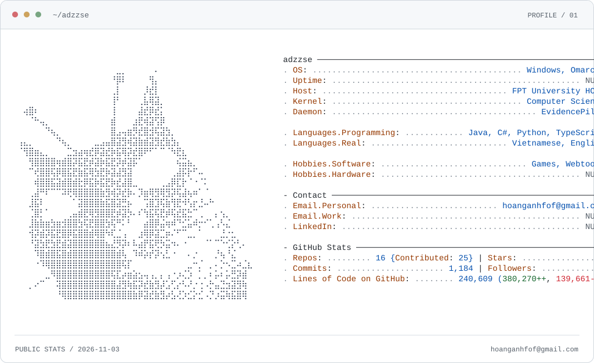

<picture>
  <source media="(prefers-color-scheme: dark)" srcset="assets/profile-dark.svg">
  
</picture>

  <a href="https://adzzse.github.io/Adzzse-portfolio/">Portfolio</a> ·
  <a href="mailto:hoanganhfof@gmail.com">Email</a> ·
  <a href="https://github.com/adzzse/EvidencePilot_models">EvidencePilot models</a> ·
  <a href="https://github.com/adzzse/GardenProfitTracker">Garden Profit Tracker</a>

  
About me · text version

  
I'm Hoang Anh Do (adzzse), focused on backend and API development.

  <ul>
    <li>Code: Java, C#, Python, TypeScript.</li>
    <li>Setup: Windows / Omarchy, VS Code, PowerShell.</li>
    <li>Education: FPT University HCMC, Computer Science.</li>
    <li>Current project: EvidencePilot. Languages: Vietnamese, English.</li>
    <li>Outside code: webtoons, games, and sleep.</li>
    <li>Side quest: creating interesting bugs.</li>
    <li>Public GitHub stats (2026-11-03): 16 repos, 25 owned/contributed repos, 1 stars, 1 followers. Commits and lines of code: NULL.</li>
  </ul>

<!-- Character portrait supplied by the profile owner. -->
